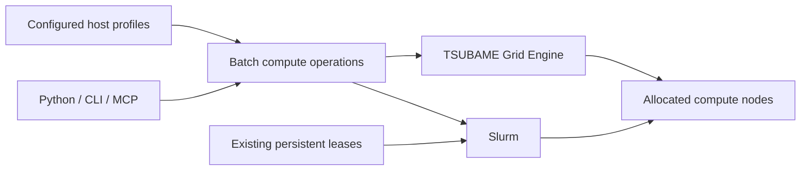

# scitex-hpc

<p align="center">
  <a href="https://scitex.ai">
    
  </a>
</p>

<p align="center"><b>HPC batch dispatch across Slurm and TSUBAME Grid Engine, with persistent Slurm allocations.</b></p>

<p align="center">
  <a href="https://scitex-hpc.readthedocs.io/">Full Documentation</a> · <code>uv pip install scitex-hpc[all]</code>
</p>

<!-- scitex-badges:start -->
<p align="center">
  <a href="https://pypi.org/project/scitex-hpc/"></a>
  <a href="https://pypi.org/project/scitex-hpc/"></a>
  <a href="https://github.com/ywatanabe1989/scitex-hpc/actions/workflows/test.yml"></a>
  <a href="https://codecov.io/gh/ywatanabe1989/scitex-hpc"></a>
  <a href="https://scitex-hpc.readthedocs.io/en/latest/"></a>
  <a href="https://www.gnu.org/licenses/agpl-3.0"></a>
</p>
<!-- scitex-badges:end -->

---

## Problem and Solution

| # | Problem | Solution |
|---|---------|----------|
| 1 | **Login nodes silently run compute** — sysadmins kill stray processes, jobs die unannounced | Scheduler submissions place workloads on allocated compute nodes; login-shell SSH resolves the scheduler tools |
| 2 | **Queue wait dominates iteration** for short multi-agent / dev workflows | **`Reservation.book(..., persistent=True)`** — book a node once, `exec()` many short commands inside the same allocation; SIGUSR1 trap auto-resubmits at walltime |
| 3 | **Per-cluster knob soup** (partition, cpus, time, mem) repeated in every job script | Explicit scheduler profiles and portable batch requests, alongside the existing `JobConfig` configuration cascade |

## Installation

```bash
pip install scitex-hpc
```

## Quick Start

The new `scitex_hpc.scheduler` interface provides `ComputeClient`,
`BatchRequest`, explicit `HostProfile` configuration, dry-run plans,
submission, conservative status interpretation, and cancellation for Slurm
and the TSUBAME Grid Engine dialect. Python, CLI, and FastMCP adapters share the same operations.
This is a single-node batch subset, not a claim of live site admission,
interactive Grid Engine leases, MPI, arrays, renewal, or Web API serving.

```python
from scitex_hpc.scheduler import BatchRequest, ComputeClient, HostProfile

client = ComputeClient(HostProfile(host="my-slurm-alias", scheduler="slurm"))
request = BatchRequest(
    argv=("python3", "analysis.py"),
    working_directory="~/proj/my-project",
    cpus=4,
    memory_mib=4096,
    walltime_seconds=60,
)
plan = client.plan(request)  # Pure planning: no SSH or cluster submission.
```

Read the [scheduler portability guide](src/scitex_hpc/_skills/scitex-hpc/19_scheduler-portability.md)
for profile examples, CLI commands, resource-bundle semantics, module setup,
MCP operations, and uncertain submission outcomes. The same guide ships in the
installed skills. Existing Slurm APIs and persistent leases remain available.

## Architecture



Site settings belong in `~/.scitex/hpc/config.yaml` (relocatable through
`SCITEX_DIR`). Named scheduler profiles reference SSH aliases and verified
site resource mappings; they do not duplicate the Dev hosts registry or store
credentials. Compute runs inside scheduler allocations, not on login nodes.

## 1 Interfaces

<details open>
<summary><strong>Python API ⭐⭐⭐ (primary)</strong></summary>

<br>

```python
from scitex_hpc import JobConfig, srun, sbatch, sync, poll_job, fetch_result

cfg = JobConfig(
    project="scitex-dsp",
    command="pip install -e '.[dev]' -q && python -m pytest tests/ -n 16",
    host="spartan", partition="sapphire",
    cpus=16, time="00:30:00", mem="64G",
)

sync(cfg)                           # 1. push local sources to the cluster
exit_code = srun(cfg)               # 2a. blocking interactive run
job_id = sbatch(cfg)                # 2b. async batch submission
print(poll_job(cfg, job_id))        # {'state': 'COMPLETED', 'exit_code': '0:0', ...}
fetch_result(cfg, job_id)           # downloads the .out file
```

### Reservations (book once, exec many)

```python
from scitex_hpc import JobConfig, Reservation

res = Reservation.book(
    JobConfig(project="dev-pool", host="spartan", partition="cascade",
              cpus=8, mem="32G", time="7-0"),
    persistent=True,                # walltime auto-resubmit via SIGUSR1
)

res.exec("hostname")
res.exec(["python", "-m", "unittest", "discover"])
res.attach(cmd="bash")              # interactive shell on the compute node

# Look up later by friendly name (state in ~/.scitex/hpc/leases/)
res = Reservation.get("dev-pool")
res.release()                       # scancel + clear state
```

</details>

<details>
<summary><strong>CLI ⭐⭐</strong></summary>

<br>

```bash
scitex-hpc lease book dev-pool --host spartan --cpus 8 --mem 32G --time 7-0 --persistent
scitex-hpc lease list
scitex-hpc lease exec dev-pool 'hostname'
scitex-hpc lease attach dev-pool
scitex-hpc lease cancel dev-pool
```

> `reservations` is a **deprecated alias** for `lease` — existing
> `scitex-hpc reservations …` callers keep working (with a one-line
> deprecation notice on stderr), but `lease` is the documented name.

</details>

## Defaults & overrides

Every `JobConfig` field has a `SCITEX_HPC_*` env-var override:

| Field | Default | Env override |
|---|---|---|
| `host` | `spartan` | `SCITEX_HPC_HOST` |
| `partition` | `sapphire` | `SCITEX_HPC_PARTITION` |
| `cpus` | `16` | `SCITEX_HPC_CPUS` |
| `time` | `00:20:00` | `SCITEX_HPC_TIME` |
| `mem` | `128G` | `SCITEX_HPC_MEM` |
| `remote_base` | `~/proj` | `SCITEX_HPC_REMOTE_BASE` |

Resolution priority: explicit `JobConfig` field → env var → built-in default.

## Walltime auto-resubmit (`persistent=True`)

When `persistent=True`, scitex-hpc:

1. Adds `#SBATCH --signal=B:USR1@3600` so SLURM signals the script 1 h before walltime.
2. Wraps the sbatch body with a SIGUSR1 trap that calls `sbatch "$0"` to resubmit itself.
3. The friendly name (`dev-pool`) stays stable across resubmits; the SLURM `job_id` changes.

```python
res = Reservation.get("dev-pool")
res.refresh()                       # squeue --user --name=dev-pool
res.exec("...")                     # uses the new job_id
```

SLURM's documented signaling mechanism — no custom daemon. Compatible with HPC policies that ban persistent user-space daemons. SSH ControlMaster pooling on the calling host amortizes per-`exec()` handshake cost.

## Part of SciTeX

`scitex-hpc` is part of [**SciTeX**](https://scitex.ai). Install via
the umbrella with `pip install scitex[hpc]` to use as
`scitex.hpc` (Python) or `scitex hpc ...` (CLI).

>Four Freedoms for Research
>
>0. The freedom to **run** your research anywhere — your machine, your terms.
>1. The freedom to **study** how every step works — from raw data to final manuscript.
>2. The freedom to **redistribute** your workflows, not just your papers.
>3. The freedom to **modify** any module and share improvements with the community.
>
>AGPL-3.0 — because we believe research infrastructure deserves the same freedoms as the software it runs on.

---

<p align="center">
  <a href="https://scitex.ai" target="_blank"></a>
</p>
